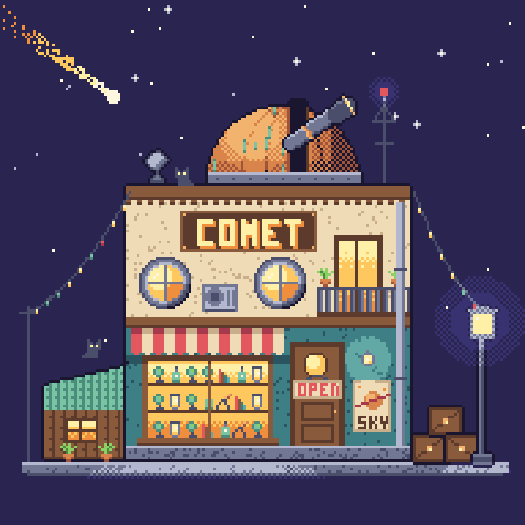
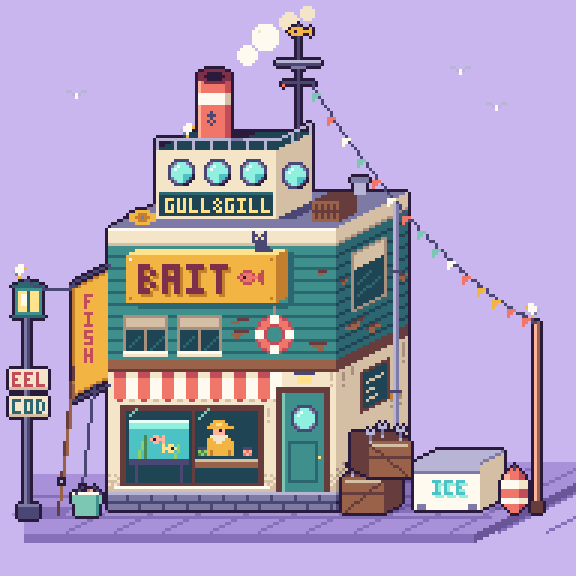
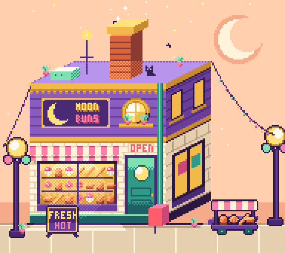
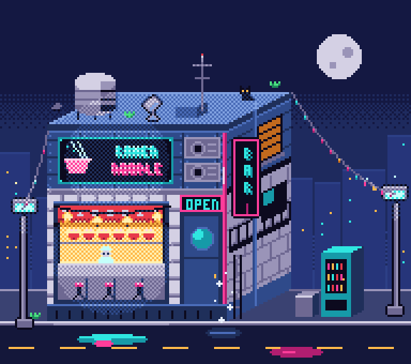
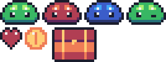
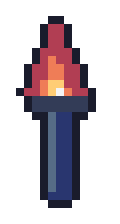

# pxl

**Pixel art as code.** Write a compact `.px.js` file; get PNGs, sprite sheets with JSON, animated
GIFs, and a live browser viewer that replays the painting step by step as you save.

Built for AI agents (it ships as a ready-made [agent skill](#use-it-with-an-ai-agent)) and pleasant
for people too. No runtime dependencies, no build step: just Node ≥ 22.18.

<p>
  
</p>
<p>
  
  
  
  
</p>
<p>
  
  
  
  
</p>

Every image above is generated from a file in [`examples/`](examples).

## This fork

A fork of [crsolver/claude-pxl](https://github.com/crsolver/claude-pxl) (all credit for pxl itself
goes there) that adds tools aimed at one thing: **art that reads as hand-made pixel art**, not
"shapes filled with a gradient". Part of a family with [**vex**](https://github.com/uilianks/vex) (vector art, skeletal animation), [**chirp**](https://github.com/uilianks/chirp) (game audio), [**kiln**](https://github.com/uilianks/kiln) (low-poly and voxel 3D) and [**loom**](https://github.com/uilianks/loom) (seamless textures and PBR materials).

<p></p>

- **`shades("1234", "#c8323c")`**: builds a hue-shifted ramp from one color. Shadows go cool and
  more saturated, lights go warm and paler, and the ramp is wired up for `shade()`/`light()`.
- **`selout: "k"`**: a selective outline. Each outline pixel takes the color it touches, two ramp
  steps darker, so the line softens on lit edges and deepens in shadow.
- **`pxl lint`**: an art critic for built pixels. It flags orphan pixels, jaggies (doubled corners
  in 1-px lines), pillow shading, too many colors and near-duplicate colors, each with coordinates
  and a `_preview/<name>.lint.png` overlay. Agents run it before they call a sprite done.
- **Annotate mode in the live viewer** (`✎ annotate` or `a`): paint over an asset (markup colors
  point at things, palette colors mean "make it this color"), pin numbered notes to pixels, add a
  comment, and press *send to Claude*. It writes `out/_feedback/<asset>.json` (every painted pixel,
  every note with the pixel under it) and an annotated PNG, so you can say "check the feedback"
  instead of describing where the problem is.

The before/after is [`examples/polish.px.js`](examples/polish.px.js): `lint` flags the left
mushroom for pillow shading and passes the right one.

<p>
  
</p>

*The Watcher in the Frame* ([`showcase/eldritch.px.js`](showcase/eldritch.px.js), 130×160) was
directed with annotate mode: the creature is a small 3D model rendered into pixels (ellipsoids
shaded from their normals with `shades` ramps, tentacles as tubes) and every revision after the
first round came from painted marks and notes.

## Quick start

```sh
git clone https://github.com/uilianks/pxl.git
cd claude-pxl
node bin/pxl.js serve examples/shop.px.js     # live viewer at http://127.0.0.1:4321/
```

Or run it without cloning:

```sh
npx github:uilianks/pxl build art.px.js
```

Write `art.px.js`:

```js
pal({ k: "#1b1630", g: "#8ccf63", G: "#4c8a44", w: "#fff6e0", r: "#e2585e", R: "#a63a4c" })

// Write the left half; mirror it and outline it automatically.
sprite("slime", { mx: true, outline: "k" }, `
  ....ggg
  ..ggGGg
  .ggGwGg
  gggkwgg
  GGGGGGG`)
sprite("slime_red", { base: "slime", swap: { g: "r", G: "R" } })   // a recolor in one line

sheet("chars", ["slime*"], { pad: 1 })
```

```sh
node bin/pxl.js build art.px.js
```

```
out/sprites/slime.png  out/sprites/slime_red.png      the art, at 1x
out/chars.png          out/chars.json                 sprite sheet + TexturePacker-style JSON
out/_preview/*.png                                    upscaled previews with a pixel grid
```

`--godot` also writes a Godot 4 `SpriteFrames` `.tres` beside every sheet and anim strip (one animation
per tag, with frame durations and loop), ready for an `AnimatedSprite2D`.

## Examples

Each image is built by `npm run examples` from the file named under it (sources in
[`examples/`](examples), images in [`docs/gallery/`](docs/gallery)).

**Sprites, recolors and a sheet**: draw the left half, mirror it, outline it, then make variants by
swapping colors. [`examples/basics.px.js`](examples/basics.px.js)

```js
sprite("slime", { mx: true, outline: "k" }, `
  ....ggg
  ..ggGGg
  .ggGwGg
  .gggggg
  gggkwgg
  gggkkgg
  tgggggg
  .tttttt`)
sprite("slime_red", { base: "slime", swap: { g: "r", G: "o", t: "p" } })
sprite("slime_blue", { base: "slime", swap: { g: "b", G: "B", t: "n" } })
sprite("coin", { w: 10, h: 10 }, circ(4, 4, 4, "o"), circ(4, 4, 3, "y"), vline(4, 2, 5, "o"), px(3, 2, "w"))
sheet("chars", ["slime*", "heart", "coin", "chest"], { cols: 4, pad: 1 })
```



**A procedural animation, placed in a sprite**: the flame's frames come from `c.phase`, so it loops
seamlessly; the torch that stamps it is animated too. With `--godot` the build also writes
`anims/flame.tres`, a `SpriteFrames` for Godot. [`examples/torch.px.js`](examples/torch.px.js)

```js
anim("flame", { w: 9, h: 12, frames: 6, fps: 10 }, (c) => {
  const k = c.phase * Math.PI * 2, sway = Math.round(Math.sin(k) * 1.2)
  c.poly([0, 11, 4 + sway, Math.round(1 + Math.sin(k * 2)), 8, 11], "r")
  c.poly([2, 11, 4 + sway, Math.round(4 + Math.cos(k * 2)), 6, 11], "o")
  c.poly([3, 11, 4, Math.round(7 + Math.sin(k)), 5, 11], "y")
  c.px(4, 10, "w")
})
sprite("torch", { w: 13, h: 26, outline: "k" },
  rect(5, 12, 3, 12, "n"), rect(3, 11, 7, 2, "d"), vline(5, 13, 10, "s"), stamp("flame", 2, 0))
```



**Frames as patches**: a cat drawn once, then each `frame()` changes only the tail.
[`examples/no_magic.px.js`](examples/no_magic.px.js)

```js
anim("cat", { outline: "k" }, `
  .......................sK.
  ........................K.
  .s...s..................K.
  .Ks.sKs........sssss...K..
  .KKKKKK......ssKKKKKs.Ks..
  KKKKKKKs...ssKKKKKKKKKK...
  KkYKKkYKsssKKKKKKKKKKKK...
  KKKKKKKKKKKKKKKKKKKKKKK...
  .KKqKKrKKKKKKKKKKKKKKKK...
  ..KKKKrKKKKKKKKKKKKKKKK...
  ...KKKaKKKKKKKKKKKKKKK....
  .KKKKK.KKKK...KKKKKKK.....
  KKKKK.KKK....KKKKKKK......`,
  frame({ ms: 300 }), frame({ ms: 300 }, grid(23, 0, "__K")), frame({ ms: 300 }, grid(23, 0, "_K")),
  frame({ ms: 300 }, grid(22, 0, "sK_")))
```


## The live viewer

`pxl serve art.px.js` opens a viewer that rebuilds on every save and replays the asset you edited
op by op, so you (or whoever is watching an agent work) can see the art being painted. It also
writes the same `out/` files as `build`.

## Commands

```
pxl build <art.px.js> [--out DIR] [--only a,b] [--scale N] [--no-preview] [--godot]
pxl serve <art.px.js> [--port 4321] [--out DIR | --no-out] [--no-preview]
pxl ascii <art.px.js> <name>     print an asset as palette keys with x/y rulers
pxl list  <art.px.js>            list assets, groups and sheets with source locations
pxl lint  <art.px.js> [name ...] critique pixels: orphans, jaggies, pillow shading, palette
pxl trace <image.png> [--w N] [--colors 16 | --palette pico8] [--dither 0.3]
                                 turn a PNG into an art file: extracted palette + grid, with its fidelity
```

`pxl` means `node bin/pxl.js` in a clone, or `npx github:uilianks/pxl`. Art files can be `.js` or
`.ts` (`types/pxl.d.ts` gives editor completion).

## What's in the DSL

- **Palettes and ramps**: one-character color keys, built-in palettes (pico8, sweetie16, endesga32…),
  dark→light ramps that drive `shade()` / `light()`.
- **Sprites**: text grids, mirroring, auto-outline, palette-swap variants, flips/rotations, reusable
  `_parts`, `stamp`.
- **Primitives and brushes**: rects, lines, circles, polygons, gradients, dithering, noise, a built-in
  pixel font, `scatter` brushes, tilemaps, random groups with reproducible seeds.
- **Scenes**: layers, cast-shadow and light layers, per-layer PNG export.
- **Animation**: frames as patches over a base sprite → strips + JSON tags + GIF.
- **Lighting** (optional): lamps, glow, normal-based relief (see [`lighting.md`](lighting.md)).
- **Images in, pixel art out**: `image("photo.png", x, y, { w: 64, palette: "kgGw", dither: 0.3 })` draws
  any PNG (a photo, a reference, a kiln or vex render) quantized to the palette; `pxl trace` writes a whole
  art file from one. `isobox` draws 2:1 isometric blocks; `rot` takes any angle.
- **Errors** point at `file:line:col` and the asset/layer/op path, with "did you mean…" hints.

Full API: [`reference.md`](reference.md). Agent workflow and essentials: [`SKILL.md`](SKILL.md).

## Use it with an AI agent

This repository is an agent skill: `SKILL.md` teaches the workflow (write → build → look at the
preview → patch), `reference.md` holds the full API, and `lighting.md` is loaded only when needed.

**Claude Code**: clone it into your skills folder, then ask Claude to draw something.

```sh
# all projects
git clone https://github.com/uilianks/pxl.git ~/.claude/skills/pxl-pixel-art
# or just one project
git clone https://github.com/uilianks/pxl.git .claude/skills/pxl-pixel-art
```

**Other agents** (Codex, Cursor, …): point them at `SKILL.md` and tell them the CLI is
`node <path to pxl>/bin/pxl.js`.

Tip: ask the agent to start `pxl serve` so you can watch it paint in your browser.

## Development

```sh
npm install        # dev only: typescript, @types/node
npm run check      # type check + tests + build every example and regenerate docs/gallery
npm run examples   # just the examples and the gallery
```

```
src/core/     engine, no Node APIs: image, palette + ramps, canvas ops, build, trace, project
src/node/     vm sandbox loader, PNG/GIF encoders, outputs, CLI, live server
src/viewer/   browser viewer (served type-stripped; no bundler)
types/        pxl.d.ts globals for editor support in .px.ts files
scripts/      build.js (dist/ for npm installs), examples.ts, gallery.ts
examples/     example art files
test/         node:test suites
```

In a clone the CLI runs the TypeScript sources directly. When installed as a package it runs
`dist/`, which `npm install` / `npm pack` generate via `scripts/build.js` (Node won't strip types
inside `node_modules`).

## License

[MIT](LICENSE). Copyright crsolver (original pxl); fork additions by uilianks under the same license.

## Support

If this tool helps you, you can support its development on [Ko-fi](https://ko-fi.com/uiliankidricki).
